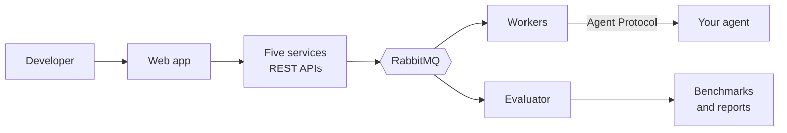

# AgentArena

[](../../actions/workflows/ci.yml)

AgentArena tests, simulates and benchmarks AI agents. Connect an agent over HTTP, run it through scripted scenarios, and find out how often it does the right thing, what it gets wrong, how fast it is and what it costs.

It is for teams shipping AI agents who need more than a demo to trust them. A customer-support agent can be put through incomplete requests, contradictions, tool outages and prompt injection, and a new version can be compared with the last one, scenario by scenario, before it goes live.

Scores are deterministic, so a benchmark means the same thing next month. The optional LLM judge adds comments, and never changes a score.

## Run it

You need Docker Desktop. The stack uses about 3 GB of memory.

```bash
cp .env.example .env
docker compose up --build --wait
python scripts/seed_demo.py
```

The last command is optional, and on Windows it may be `py` instead of `python`. It creates a demo account and runs real benchmarks of a flawed and a fixed version of the sample agent. Then sign in at <http://localhost:8080> as `demo@example.com`, with `DEMO_USER_PASSWORD` from `.env`.

| Tool | Address |
| --- | --- |
| Web app and API gateway | <http://localhost:8080> |
| Grafana (user `admin`, password in `.env`) | <http://localhost:3000> |
| Jaeger | <http://localhost:16686> |
| Prometheus | <http://localhost:9090> |
| RabbitMQ management | <http://localhost:15672> |

To run on local Kubernetes instead, see [docs/deployment.md](docs/deployment.md).

## How it works



| Service | Responsibility | Database |
| --- | --- | --- |
| [identity-service](services/identity-service) | Accounts, organizations, tokens | `identity_db` |
| [agent-registry](services/agent-registry) | Agents, versions, encrypted credentials | `agents_db` |
| [scenario-service](services/scenario-service) | Scenarios, suites, datasets, variations | `scenarios_db` |
| [run-orchestrator](services/run-orchestrator) | Runs, scheduling, workers, recovery | `runs_db` |
| [evaluation-service](services/evaluation-service) | Scoring, benchmarks, comparisons, analytics | `evaluations_db` |

Your agent only needs one HTTP endpoint. See the [Agent Protocol](contracts/agent-protocol/README.md) and the [sample agent](examples/sample-agent).

## Documentation

| Topic | Document |
| --- | --- |
| Architecture, with C4 diagrams | [docs/architecture.md](docs/architecture.md) |
| Decisions and trade-offs | [docs/adr](docs/adr) |
| Events and service communication | [docs/communication.md](docs/communication.md) |
| Service level objectives | [docs/slo.md](docs/slo.md) |
| Load test results | [docs/loadtest.md](docs/loadtest.md) |
| Failure experiments | [docs/chaos](docs/chaos) |
| Risks | [docs/risks.md](docs/risks.md) |
| Deployment and operations | [docs/deployment.md](docs/deployment.md) |
| Rolling updates and rollback | [docs/rolling-update.md](docs/rolling-update.md), [docs/rollback.md](docs/rollback.md) |
| Final report and demo plan | [docs/report.md](docs/report.md), [docs/demo.md](docs/demo.md) |
| Engineering journal | [docs/journal](docs/journal) |
| Rules for coding agents | [AGENTS.md](AGENTS.md) |

## Tests

```bash
scripts/install-dev.sh
pytest tests/unit tests/contract
pytest tests/integration      # needs: docker compose up -d --wait postgres rabbitmq
pytest tests/e2e -m "not chaos"    # needs the running stack
cd frontend && npm test
```

## Branch protection

`main` should require the `CI` workflow to pass, through a branch ruleset. A private repository needs GitHub Pro for this, which is free with the Student Developer Pack. Until then the equivalent rule is to work on branches and merge only when CI is green.
