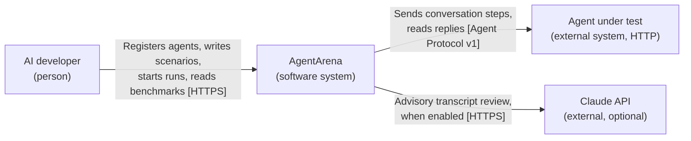
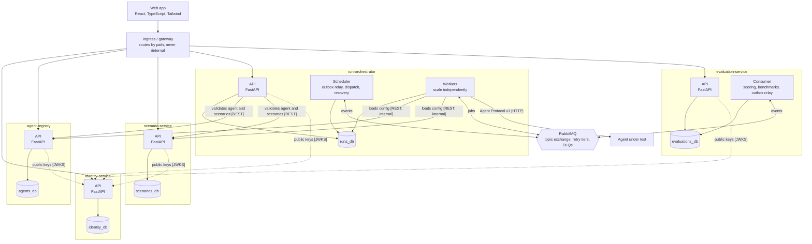

# Architecture

AgentArena lets teams connect their AI agents and measure how reliably they behave. It drives an agent through scripted scenarios over HTTP, scores every interaction deterministically, and reports what failed, how fast it ran and what it cost.

## C4 level 1: system context

| Actor | Role |
| --- | --- |
| AI developer | Belongs to an organization. Owner, admin, member or viewer. |
| Agent under test | The customer's own service. It runs on their infrastructure, never inside AgentArena. |
| Claude API | Optional qualitative feedback. No score depends on it. |

## C4 level 2: containers

### Services and data owners

| Service | Owns | Database | Responsibility |
| --- | --- | --- | --- |
| identity-service | Users, organizations, memberships, signing keys | `identity_db` | Accounts, sessions, access tokens, public keys. |
| agent-registry | Agents, versions, encrypted credentials | `agents_db` | Registers and validates agents. Versions are immutable. |
| scenario-service | Scenarios, versions, suites, datasets | `scenarios_db` | Defines what is tested and what good looks like. Generates variations. |
| run-orchestrator | Runs, executions, transcripts | `runs_db` | Accepts runs, schedules work, drives agents, recovers from failures. |
| evaluation-service | Evaluations, benchmarks | `evaluations_db` | Scores executions, compares versions, serves analytics and reports. |

The Run Orchestrator is one bounded context with three processes from one image. The API accepts work, the scheduler moves runs through their lifecycle, and workers call agents. They share `runs_db`, and scale separately. The Evaluation Service has the same split between its API and its consumer.

`identity-service` is a fifth service beyond the four in the brief. [ADR 0001](adr/0001-service-boundaries-and-identity.md) explains why.

Each database has its own role, and PUBLIC has no connect privilege, so a service cannot read another service's data even on the shared local instance.

## What happens during a run

1. `POST /v1/runs` calls the Agent Registry and Scenario Service with the caller's token, so those services enforce tenant isolation themselves.
2. The run, one row per execution and `run.requested` commit in one transaction.
3. The scheduler's relay publishes the event. The scheduler fills the run's concurrency slots by marking executions dispatched and writing `execution.requested`.
4. A worker claims an execution with a row lock, starts a lease and loads the agent and scenario through internal APIs. Versions are immutable, so it caches them for 60 seconds.
5. The worker talks to the agent over the Agent Protocol and simulates its tools from the scenario, including scripted failures.
6. The transcript, final state, `execution.completed` and `evaluation.requested` commit together.
7. The evaluation consumer scores the execution. The result and `evaluation.completed` commit together.
8. Once every execution is evaluated, the scheduler finishes the run and publishes `run.completed`. The evaluation consumer stores the benchmark.

The event flow, schemas and retry rules are in [communication.md](communication.md).

## Failure handling

| Failure | What happens |
| --- | --- |
| Worker crashes | RabbitMQ redelivers the job, which is dropped as a duplicate. The lease stops being renewed and expires within 15 seconds. The scheduler then retries the execution as a new attempt. |
| Worker loses its lease but is still running | Its final write checks the worker id and attempt, finds they no longer match, and discards the result. An execution cannot record two outcomes. |
| Broker restarts | Queues are durable and quorum-based. Connections and consumers recover on their own. Outbox rows wait until the broker returns. |
| Evaluation consumer is down | Runs wait in `evaluating`. Messages stay queued and are processed on restart. After 5 minutes the run finishes with a warning. |
| Agent or Scenario service is down | Retries with jitter, then a circuit breaker fails fast. The API answers 503 with `Retry-After`. Workers retry the execution later. |
| Agent returns 5xx, times out or is unreachable | Retried up to the run's limit with backoff. A final failure still counts in the benchmark. |
| Agent returns garbage or a 4xx | Not retried, because it would fail the same way again. |
| Message cannot be processed | Three retry tiers (1 s, 5 s, 30 s), then a dead-letter queue, with an alert. Contract violations go straight to the DLQ. |

## Cross-cutting design

**Tenancy.** Every row carries `org_id` and every query filters on it. Another tenant's id returns 404, so ids cannot be probed.

**Security.** Tokens are signed with an Ed25519 key that only the identity service holds. Refresh tokens rotate, and replaying one revokes the session. Agent credentials are encrypted with AES-256-GCM, bound to their organization and agent, and never returned. Agent URLs pass an SSRF check at registration and before every call. Kubernetes denies all traffic by default and lists each allowed path.

**Observability.** Every process exposes Prometheus metrics. OpenTelemetry traces follow a run from the API through RabbitMQ to the workers and the evaluator, because trace context is stored in the outbox row and carried in message headers. Logs are JSON, with trace and correlation ids on every line.

**Reproducibility.** A run pins the agent version, each scenario version and a seed. `POST /v1/runs/{id}/replay` repeats it exactly.

## Technology choices

Decisions are recorded in [docs/adr](adr/). Technologies from the brief that were deliberately not adopted yet, and what would trigger each one, are in [ADR 0009](adr/0009-deferred-technologies.md).
