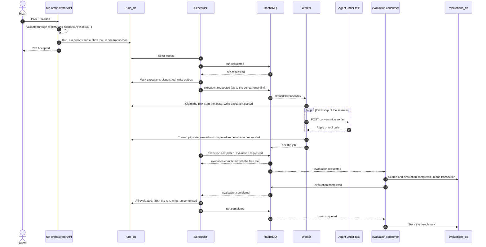

# Communication

Services talk in two ways. Synchronous REST is used when the caller needs an answer now. Asynchronous events through RabbitMQ are used for everything else, so a slow or absent consumer never blocks the work.

## Synchronous calls

| Caller | Callee | Call | Why it is synchronous | Timeout |
| --- | --- | --- | --- | --- |
| run-orchestrator API | agent-registry | `GET /v1/agents/{id}` and `/versions/{version}` | A run must be rejected at once if the agent is missing, disabled or from another organization. | 3 s |
| run-orchestrator API | scenario-service | `GET /v1/suites/{id}/resolve`, `GET /v1/scenarios/resolve` | The run must pin exact scenario versions when it is created. | 3 s |
| Worker | agent-registry | `GET /internal/v1/agents/{id}/versions/{version}` | The worker needs the endpoint and credential to start. | 3 s |
| Worker | scenario-service | `GET /internal/v1/scenarios/{id}/versions/{version}` | The worker needs the scenario to start. | 3 s |
| All services | identity-service | `GET /.well-known/jwks.json` | Public keys. Cached, so only cold starts and new keys need this call. | 3 s |
| Worker | Agent under test | `POST <endpoint>` | The agent's reply is the data being measured. | Version timeout, within the run timeout |

Every call to another service goes through `ServiceClient`, which applies:

- **Timeout** on every call.
- **Retry** for reads only: three attempts, exponential backoff with full jitter, on connection errors and 5xx. Writes are not retried.
- **Circuit breaker**, one per dependency per process: opens after 5 consecutive failures, sends one probe after 15 seconds. 4xx responses do not count, because they say nothing about the dependency's health.

The API forwards the caller's own token, so the callee enforces tenant isolation itself. Workers have no user token. They use `/internal` routes, with a shared token and an explicit organization id that scopes the lookup.

## Asynchronous flow



## Events

All events share one envelope: `event_id`, `event_type`, `event_version`, `occurred_at`, `producer`, `org_id`, `correlation_id`, `causation_id` and `data`. The schemas in [contracts/events](../contracts/events) are generated from the Pydantic models in [events.py](../shared/agentarena_common/events.py).

| Event | Producer | Consumer | Main fields | Purpose |
| --- | --- | --- | --- | --- |
| `run.requested` v1 | run-orchestrator API | Scheduler | `run_id`, `total_executions`, `concurrency` | Starts dispatching. |
| `execution.requested` v1 | Scheduler | Workers | `execution_id`, `attempt`, `dispatched_at` | A job. The row stays the source of truth. |
| `execution.started` v1 | Worker | Scheduler | `execution_id`, `worker_id`, `queue_wait_ms` | Records when the run really began. |
| `execution.completed` v1 | Worker | Scheduler | `execution_id`, `latency_ms`, `agent_calls`, `tool_calls` | Frees a concurrency slot. |
| `execution.failed` v1 | Worker, Scheduler | Scheduler | `execution_id`, `status`, `error_code`, `will_retry` | Frees a slot, or records a retry. |
| `evaluation.requested` v1 | Worker, Scheduler | Evaluation consumer | Transcript, expected outcome, criteria, metrics | Everything needed to score, so the evaluator reads no other service's data. |
| `evaluation.completed` v1 | Evaluation consumer | Scheduler | `execution_id`, `evaluation_id`, `passed`, `score` | Lets the run finish, and feeds the results list. |
| `run.completed` v1 | Scheduler | Evaluation consumer | `run_id`, `status`, `finished_at` | Triggers the final benchmark. |

Failed executions are still evaluated, so timeouts and errors count in the benchmark.

### Versioning

- A new optional field keeps the version. Consumers ignore fields they do not know.
- Removing a field or changing its meaning needs a new version. Required v1 fields are frozen in a contract test.
- A consumer sends an event with an unknown type or version straight to the dead-letter queue.

## Topology

```text
exchange agentarena.events (topic, durable)
  orchestrator.scheduler       run.requested, execution.*, evaluation.completed
  orchestrator.execution-jobs  execution.requested
  evaluation.requests          evaluation.requested, run.completed

Each queue also has:
  <queue>.retry.1s, .retry.5s, .retry.30s   hold, then dead-letter back to the queue
  <queue>.dlq                               inspected by a person, raises an alert
```

Main queues and DLQs are durable quorum queues, and messages are persistent.

## Delivery guarantees

| Mechanism | Where | What it prevents |
| --- | --- | --- |
| Transactional outbox | `outbox` table, `OutboxRelay` | A lost event, or an event for a change that rolled back. |
| Publisher confirms | `MessageBus` | Marking an event published before the broker has it. |
| Manual ack after commit | Consumers | Losing a message when a handler crashes. |
| `processed_messages` | `first_delivery()` | A redelivered message having a second effect. |
| Unique constraints | `evaluations.execution_id`, `runs(org_id, idempotency_key)` | Duplicates even if deduplication were bypassed. |
| Retry tiers and DLQ | `MessageBus` | A failing message blocking its queue forever. |
| `Idempotency-Key` header | `POST /v1/runs` | A client retry starting a second run. |
| Lease and fencing | `executions` table | A slow worker overwriting the result of its replacement. |

## Correlation and tracing

The API creates a `correlation_id`, or accepts `X-Correlation-ID`. It stays on the run and on every event, log line and outbound call. The W3C trace context is saved in the outbox row and sent in message headers, so a single trace follows the run through every service, even when the relay publishes later from another process.
